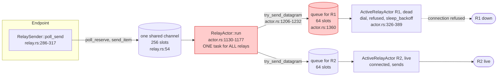
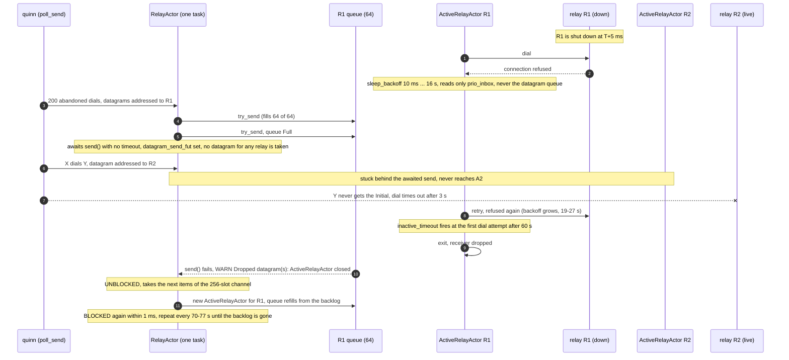
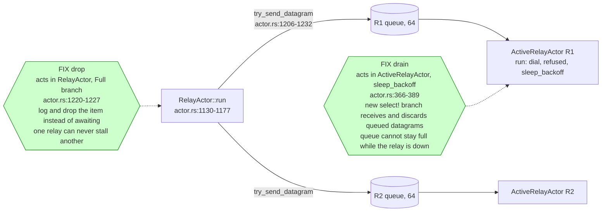

# iroh: datagrams toward an unreachable relay block all relay sends of the endpoint, including to live relays

Affects iroh 1.3.0 and main at `55908a5809b61c72ec8deeff024038f4a9d68ab7` (iroh 1.4.0); `src/socket/transports/relay/actor.rs` is byte-identical in both. Source lines below are `iroh-1.3.0/src/...` unless a rev is named.

## 1. Summary

An endpoint with a relay map of two or more relays stops sending anything through any relay when a few dozen datagrams are addressed to a relay that is down: one `RelayActor` task serves all relays' outgoing datagrams and waits, without a timeout, on the dead relay's full 64-slot queue, which its connection actor does not drain while it backs off. Every fresh `connect` and every reply to a peer on a live relay then times out, for 70 to 150+ s per blocking cycle. It hits any iroh user whose peers advertise a relay that is down (dead host, partition, restart), and it takes the whole endpoint's relay traffic with it; it is easy to hit and long-lasting.

Package layout:

| Path | Content |
|---|---|
| `README.md` | this report |
| `ISSUE.md` | short text for a GitHub issue |
| `repro/hol-repro/` | the single-file reproduction (iroh 1.3.0) |
| `repro/hol-repro-main/` | the same file built against iroh main `55908a5` |
| `repro/hol-repro-patched/` | the same file against a vendored iroh 1.3.0 with a diagnostic patch (queue and blocked-state logging, two candidate fixes) |
| `repro/hol-dials/` | an earlier two-process variant used for the workaround measurements in section 8 |
| `run.sh` | builds and runs all counts quoted below (`./run.sh quick` for a short pass) |
| `results/macos/` | raw outputs behind the macOS numbers |
| `results/linux/` | raw outputs behind the Linux numbers (Ubuntu 24.04, 2 vCPU VM) |

## 2. Environment

- Rust 1.99.1 (`rust-toolchain.toml` in each package), debug build.
- iroh =1.3.0, iroh-relay =1.3.0 (feature `server`), preset `Minimal`, `clear_ip_transports()` (relay-only), tokio 1, tracing-subscriber 0.3.23. Each package has its `Cargo.lock`.
- macOS 15.3.1 (Darwin 24.3.0 arm64), Apple M2 Max, loopback, plain-HTTP relays in process.
- Also fails on iroh main: git rev `55908a5809b61c72ec8deeff024038f4a9d68ab7` (iroh 1.4.0), same source file built by `repro/hol-repro-main` (git dependency, no source change). 20/20 FAIL on macOS and 18/20 FAIL on Linux, controls pass (section 3).
- Linux: Ubuntu 24.04.4, Linux 6.8.0-138-generic x86_64, 2 vCPU AMD EPYC-Rome VM, 3819 MiB RAM, rustc 1.99.1, loopback, debug. The single-file repro on Linux (`results/linux/repro-single-file/`): stock burst 200 19/20 FAIL, main 18/20 FAIL, burst 100 3/5 FAIL, burst 64 5/5 PASS, no-kill 10/10 PASS, burst 0 10/10 PASS, drain fix 20/20 PASS, drop fix 20/20 PASS, patched build without a fix 5/5 FAIL. The 6 passing runs out of 48 burst runs (burst >= 100 with R1 dead) had 0 failed dials: the stall never started in them (the queue did not fill), they are not recoveries. `--rebind-on-fail`: recovered 5.4 s after the burst in 2 runs (printed FAIL, because the pass rule needs zero failed dials), 1 run never stalled.
- Found originally with iroh-gossip 0.101.0 on a separate test harness (not included); the reproduction below has no gossip.

## 3. Minimal reproduction

One file, `repro/hol-repro/src/main.rs` (181 lines), one package, no gossip, two relays and two endpoints (plus a ghost id with no endpoint behind it).

```sh
cd repro/hol-repro && cargo run --quiet
```
Exit code 0 pass, 1 fail, 2 setup error; the last line is `RESULT PASS|FAIL ...`. On iroh main: `cd repro/hol-repro-main && cargo run --quiet` (same file). All counts below: `./run.sh`.

What it does:
1. Starts relays R1 and R2 in process. Binds X and Y with relay map [R1, R2]; rebinds until both are homed on R2. Y's address (id + R2 url) is in a shared `MemoryLookup`.
2. G is an id with no endpoint; its address in the lookup is id + R1 url.
3. Pre-check: X dials Y (fresh `connect`, one echo round trip). Must succeed.
4. Shuts R1 down (`Server::shutdown`). Waits 1 s.
5. Trigger: X starts `--burst N` (default 200) `connect` attempts toward G, each with a 1 s timeout, all at once. Each sends QUIC Initial datagrams addressed to R1.
6. X dials Y with a fresh connection (3 s timeout) once per second for `--wait-secs` (default 15). PASS if the first dial succeeds, else FAIL. Y is homed on the live R2; the X-to-Y dial never names R1.

Controls built in: `--no-kill` (R1 stays up), `--never-up` (R1 never started, its url is a closed port), `--burst 0`.

Failure rate (macOS, debug, one machine; each run is a fresh process with fresh ports):

| Build | Flags | Result | Raw |
|---|---|---|---|
| iroh 1.3.0 | default (burst 200, wait 15 s) | 20/20 FAIL | `results/macos/repro/runs-b200.txt` |
| iroh 1.3.0 | `--burst 200 --no-kill` (R1 alive) | 20/20 PASS | not saved (terminal); `run.sh` regenerates |
| iroh 1.3.0 | `--burst 0` (R1 dead, no trigger) | 10/10 PASS | not saved; `run.sh` |
| iroh 1.3.0 | `--burst 200 --never-up --wait-secs 6` | 5/5 FAIL | not saved; `run.sh` |
| iroh 1.3.0 | `--burst 64 --wait-secs 5` | 10/10 PASS | not saved; `run.sh` |
| iroh 1.3.0 | `--burst 100 --wait-secs 5` | 10/10 FAIL | not saved; `run.sh` |
| iroh 1.3.0 | `--burst 150 --wait-secs 5` | 10/10 FAIL | not saved; `run.sh` |
| iroh 1.3.0 | single runs at burst 65 / 66 / 67 / 68 / 70 / 75 / 80 | F / P / P / P / P / P / F | not saved |
| iroh main 55908a5 | `--burst 200 --wait-secs 8` | 20/20 FAIL | `results/macos/repro/runs-main-b200.txt` |
| iroh main 55908a5 | `--burst 200 --no-kill` | 10/10 PASS | not saved; `run.sh` |

Linux counts are in section 2 and `results/linux/repro-single-file/` (`stock-b200.txt`, `stock-nokill.txt`, `stock-b0.txt`, `stock-b64.txt`, `stock-b100.txt`, `stock-rebind.txt`, `main-b200.txt`, `patched-drain.txt`, `patched-drop.txt`, `patched-stock.txt`).

The trigger is a count, not a rate. Below about 65 abandoned dials the queue never fills (the dead relay's actor is still in its 10 ms-scale early backoffs and drains by the flush path); above about 100 it always fills. 65 to 99 is a race between the burst and the actor's early retry cycles (single runs only).

Failing run, iroh 1.3.0, 200 s window (`results/macos/patched-diag/run-stock-200s.txt`; the diagnostic patch was built in but no fix switch was set, so behavior is stock; the default build prints the same shape):

```
T +0ms setup done: x_home=[R2] y_home=[R2] r1_up=true
T +5ms pre-kill x->y ok in 5ms
T +5ms R1 shut down
T +1006ms burst of 200 connect attempts toward the ghost (addr id + R1 url)
T +4011ms x->y FAIL (0ms after burst): timeout after 3s
T +8015ms x->y FAIL (4004ms after burst): timeout after 3s
...
RESULT FAIL burst=200 kill=true never_up=false failed_dials=50 first_ok_after_burst_ms=None wait_secs=200
```

## 4. Observed vs expected

Expected: a relay that is down delays or loses only datagrams addressed to it. X to Y, both on the live R2 and neither naming R1, completes in single-digit milliseconds as before the kill (pre-kill 5-6 ms).

Observed (iroh 1.3.0 and main):
- X to Y (and Y to X, whose reply X cannot send) times out. The first failed dial starts right after the burst; all dials fail for the whole window.
- Recovery needs the dead relay's actor to exit. Burst 200, no further traffic to the dead relay: no X-to-Y success in 150 s on 1.3.0 (`results/macos/repro/recovery-1.3.0.txt`), none on main in 150 s (`recovery-main.txt`), none in 200 s on the patched build with no fix set: blocked intervals of 71.5 s and 76.8 s, then blocked again (`results/macos/patched-diag/diag-stock-200s.txt`). Burst 100: first success 140.2 s after the burst (`recovery-b100.txt`). A smaller two-process variant that stopped sending to the dead peer at 25 s recovered at 73.7 s (`results/macos/two-process/p1s25.txt`).
- The same mechanism in an iroh-gossip test (macOS, member traces in `results/macos/gossip-harness-trace/`): fresh dials between two members on the live relay fail from 13 s after the kill and recover at 70.5 s.

```mermaid
gantt
    title Failing run, burst 200 (seconds after the burst starts; values from results/macos/patched-diag)
    dateFormat X
    axisFormat %s
    section Relay R1
    R1 down, connection refused on every redial        :done, r1, 0, 199
    section RelayActor, single task for all relays
    blocked cycle 1, queue 64 of 64, ends at 71.5 s    :crit, b1, 0, 72
    blocked cycle 2, ends at 148.3 s                   :crit, b2, 72, 148
    blocked cycle 3, still blocked at window end 199 s :crit, b3, 148, 199
    section X dials Y on live R2
    every dial times out after 3 s, 50 failures        :crit, d1, 0, 199
```



## 5. Mechanism

Send path of a datagram addressed to relay URL R:



1. `RelaySender::poll_send` reserves a slot in a 256-slot channel and enqueues (`src/socket/transports/relay.rs:54` creates `mpsc::channel(256)`; `poll_send` at `relay.rs:286-317`). One channel, shared by all relays.
2. One `RelayActor` task consumes that channel (`src/socket/transports/relay/actor.rs:1130-1177`, `run`). For each item it calls `try_send_datagram` (`actor.rs:1206-1232`), which picks the `ActiveRelayActor` for the item's url and `try_send`s to its 64-slot queue (`datagrams_send_queue`, created at `actor.rs:1360`: `mpsc::channel(64)`).
3. If that queue is full, `try_send_datagram` returns a future that awaits `sender.send(item)` with no timeout (`actor.rs:1220-1227`). `run` stores it in `datagram_send_fut` (`actor.rs:1137`, set at `1168`) and, while it is set, does not poll the channel (`actor.rs:1159`, guard `if datagram_send_fut.is_none()`; the comment at `1135-1136` says so: "We can not process further datagrams during this time"). So one full per-relay queue stops delivery of every datagram for every relay, including relays that are up.
4. The dead relay's `ActiveRelayActor` does not drain its queue while backing off. Its loop is `run` (`actor.rs:326-355`): `run_once` dials (`run_dialing`, `actor.rs:451-553`), the dial fails at once (connection refused), then `sleep_backoff` (`actor.rs:366-389`; backoff 10 ms to 16 s with jitter, `build_backoff`, `392-400`). `sleep_backoff` selects only on `stop_token`, `prio_inbox` and the sleep. It never reads `relay_datagrams_send`.
5. The only place queued datagrams are dropped while not connected is the 3 s `send_datagram_flush` tick inside `run_dialing` (`actor.rs:460-463`, `514-522`). A dial that fails in under a millisecond leaves `run_dialing` long before the first tick, so the flush never runs against a refused connection. (A dial that hangs on a black-holed address would reach the tick; not tested.)
6. What ends the block: `inactive_timeout` (`RELAY_INACTIVE_CLEANUP_TIME` = 60 s, `actor.rs:68`; reset only at `actor.rs:515` (flush) and `672` (connected writes), otherwise set at construction, `284`). It is polled in the `select!` of `run_dialing` (`actor.rs:524-527`), which is entered once per backoff cycle. So the actor exits at the first dial attempt after the 60 s mark: 61 to 80 s after the last reset in the traces (backoff delays reach 19-27 s). On exit the receiver drops, the pending `send` fails, `WARN Dropped datagram(s): ActiveRelayActor closed` is logged (`actor.rs:1216`, `1224`) and `RelayActor` resumes.
7. Why it comes back: the `RelayActor` then takes the next items of the 256-slot channel, which hold more datagrams for R. `active_relay_handle` creates a new actor (`actor.rs:1322-1337`), its queue fills again, and the block repeats (diagnostic log: UNBLOCKED and BLOCKED within 1 ms, twice). Total time to clear = number of 65-item cycles in the backlog times about 70 s. Traffic that keeps being addressed to R (retransmits, keep-alives, further dials) keeps refilling it.
8. Knock-on effect at the QUIC layer: with `RelayActor` stalled, the 256-slot channel fills and `poll_reserve` in `poll_send` returns Pending, so the endpoint's relay transport stops accepting datagrams too (reading of `relay.rs:286-292`; not separately observed). Established connections to peers on live relays starve and idle out (observed in the gossip test: heartbeats stop 13 s after the kill, connections close at the 10 s idle timeout).



Why `remove_relay` and lookup removal do not help:
- `Endpoint::remove_relay` calls `Socket::remove_relay` (`src/socket.rs:1245-1252`), which edits the relay map and sends `ActorMessage::RelayMapChange`; that handler only calls `re_stun` (`socket.rs:1759-1762`, `1777-1779`; on main `socket.rs:1248-1255`, `1762`, `1794`). In `actor.rs` the relay map is read in exactly one place, to fetch the auth token when an actor is started (`actor.rs:1346`). Nothing closes the active actor of a removed relay, and `try_send_datagram` routes by the item's own url, not by the map. Measured: no effect (section 8).
- Removing the peer from a `MemoryLookup` does not stop sends: the per-peer remote state already holds the learned addresses (not read in full; measured no effect, 1 run).

`Dropped datagram(s): ActiveRelayActor closed` is logged at WARN only when the actor goes away; nothing is logged while `RelayActor` is blocked.

## 6. Causal proof

Method: `repro/hol-repro-patched`, the same `main.rs`, built against a vendored copy of iroh 1.3.0 (`[patch.crates-io]`; `vendor/` is generated by `sh vendor.sh` from the cargo registry plus `hol-iroh-1.3.0.patch`, 78 lines, only `actor.rs`). DIAGNOSTIC; not for merging. Runtime switches: `HOL_DIAG=1` logs; `HOL_FIX=drain|drop` selects a candidate fix; neither set = stock behavior (macOS 20/20 FAIL, same as unpatched; Linux 5/5 FAIL).

(a) Observation. `HOL_DIAG=1`, burst 200, kill (`results/macos/patched-diag/diag-stock.txt`, `diag-stock-200s.txt`):
```
HOLDIAG 1792531687962 sleep_backoff url=R1 delay=15.05ms queue_len=51
HOLDIAG 1792531687967 try_send_datagram Full url=R1 queue_len=64 max=64
HOLDIAG 1792531687967 RelayActor BLOCKED: datagram_send_fut set, no datagram from any relay is taken until it completes
HOLDIAG ...989 sleep_backoff url=R1 delay=31ms   queue_len=64
... (every later backoff: queue_len=64, delays 46ms 123ms 290ms 480ms 1.17s 2.5s 3.7s 6.4s 18.6s)
```
200 s run: BLOCKED at 1792532947941, UNBLOCKED at 1792533019472 (71.5 s), BLOCKED 1 ms later, UNBLOCKED at 1792533096223 (76.8 s), BLOCKED again 0 ms later. No UNBLOCKED between. The queue length is 64 at every backoff entry; the blocked state is set once and held. Each UNBLOCKED coincides with `Inactive, exiting` of the R1 actor and the WARN (relay-level debug trace of the two-process variant, `results/macos/two-process/trace-p1-relay.log.gz`, shows the same pairing: exit at 20:34:00.491582, WARN at 20:34:00.491831).

(b) Candidate fixes, each 20 runs at `--burst 200 --wait-secs 8`, plus a 2000 burst:

| Switch | Change | 20 runs | burst 2000: kill / never-up / no-kill |
|---|---|---|---|
| none (stock) | none | 20/20 FAIL | not run / not run / PASS |
| `HOL_FIX=drain` | `sleep_backoff` also receives from `relay_datagrams_send` and discards (new `select!` branch after the `stop_token` branch) | 20/20 PASS | PASS / PASS / PASS |
| `HOL_FIX=drop` | in `try_send_datagram`'s Full branch, log and return `None` instead of a waiting future | 20/20 PASS | PASS / PASS / PASS |

Linux: drain 20/20 PASS, drop 20/20 PASS, none 5/5 FAIL (`results/linux/repro-single-file/patched-*.txt`). With `drain` at burst 2000, `RelayActor` blocked once for 1 ms (`results/macos/patched-diag/diag-drain-burst2000.txt`). With `drop` at burst 2000, 1264 datagrams were dropped at the Full branch and `RelayActor` never blocked. The 20-run macOS counts for the fixes were printed to the terminal, not saved as files; `run.sh` regenerates them.



Trade-offs:
- `drain`: drops datagrams addressed to a relay that is not connected, as the 3 s flush in `run_dialing` already does (the comment at `actor.rs:453-458` accepts that). Smallest change; keeps backpressure for connected relays. Still allows a short block (until the next `sleep_backoff` entry or flush) while the actor is inside a long dial; a hanging dial reaches the 3 s flush, a refused one now drains. Does not stop the shared channel from holding stale datagrams for a dead relay in front of fresh ones. QUIC retransmits; DISCO packets have no retry (same caveat as the existing flush).
- `drop`: structural fix; one slow or dead relay can never stall another. Cost: loses backpressure for a live relay whose queue is full (a slow but connected relay now drops tail datagrams and QUIC sees loss instead of delay, which changes congestion behavior), and a burst toward a healthy relay can lose datagrams that waiting would have delivered. Probably wants a per-relay policy: wait only when the relay is connected, drop when it is not.
- Both: untested beyond this repro (no gossip, no hole-punching, no multi-peer load), one runtime path each; neither is a reviewed patch.

## 7. Linux versus macOS

An iroh-gossip test harness on Linux first showed no fresh dial succeeding after 60 s in 88 s windows (0/6 runs; macOS 5/8). A 180 s rerun resolved it (`results/linux/gossip-harness-180s/`, Ubuntu 24.04 VM, one traced run per cell): the 60 s exit happens on Linux. In the traced run (kill at 21:12:34.233 UTC) each member's dead-relay actor logged `Inactive, exiting. RELAY_INACTIVE_CLEANUP_TIME=60s` at 61.1 s (member 2), 76.5 s (member 3) and 79.6 s (member 1) after the kill, member 1 again at 145.9 s, each with `Dropped datagram(s): ActiveRelayActor closed` when the test's dial probers were on (`exit-lines-w.txt`; without probers the exits are in `exit-lines-npw.txt` with no WARN). Each pair's first fresh-dial success came 0.1 to 2.4 s after the later of its two members' exits (6 pairs, one run). First success after 60 s: 74 to 87 s in 4/4 probers-on runs. The earlier 0/6 came from an 88 s window that ends 1 to 14 s after the release begins.

This fits the mechanism step for step: exit time 61-80 s (section 5, item 6: the exit waits for the next dial attempt after 60 s; extra resets of the clock are not excluded), recovery within 2.4 s of the exit, a second exit at 145.9 s (item 7: the backlog refills a new actor). It is not a Linux-specific failure. The single-file repro on Linux fails 19/20 (stock) and 18/20 (main) rather than 20/20 (section 2); with n=20 that is within chance, and no per-run trace was kept for the stall-free runs, so why they did not stall is not established.

Not explained by this bug: in the gossip test, heartbeats never resumed on Linux in 180 s (0/16 stalled pairs) although fresh dials succeeded from 74 s on. That is a second effect in the gossip layer after the transport recovers; it is outside this report and not investigated.

## 8. Impact and workarounds

Impact. Any endpoint configured with 2+ relays, where any peer advertises (in `EndpointAddr`, lookup, or tickets) a relay that is down or unreachable, and where the endpoint addresses 65+ datagrams to it before the dead relay's connection actor's first long backoff ends. Typical sources: dialing a peer whose home relay died, QUIC retransmits and keep-alives of existing connections to such peers, protocol layers that dial many peers (in the two-process variant, 1 dial/s toward a dead peer filled the queue in 17 s; 5/s in 4 s). Effect: all relay traffic of that endpoint stops for 70 s to several minutes, not only traffic to the dead relay. An endpoint with one relay is not affected (nothing else to block). Also reachable with a relay URL that was never up (`--never-up`).

Workarounds measured (two-process variant `repro/hol-dials`, and the single-file repro; macOS). Variant names: `p<N>` = X dials the dead peer N times per second and never stops; suffix `s<N>` = X stops dialing it at N s after the kill; `a<N>` = the peer's lookup entry is removed at N s; `rm` = `remove_relay(R1)` on X 0.5 s after the kill; `rmall` = on X and Y.

| Workaround | Measured effect | Raw |
|---|---|---|
| Stop addressing peers that live on the dead relay before the queue fills (`p1s5`: stop dialing the dead peer 5 s after the kill) | no stall, 2/2 runs. Stopping at 25 s (after the stall began, `p1s25`): recovery only at the actor exit, 73.7 s (1 run). Needs the application to learn the relay is dead and to control all traffic toward it; QUIC retransmits of existing connections are not controlled. | `results/macos/two-process/p1s5.txt`, `p1s5-b.txt`, `p1s25.txt` |
| Close the endpoint and bind a new one with the same key after the first failed dial (`--rebind-on-fail`; also drops the dead address) | macOS: X-to-Y succeeds 7.4 s after the burst in 3/3 runs (3 s failed dial + close + bind; output not saved as a file). Linux: 5.4 s after the burst in 2 runs, 1 run never stalled. Drops all connections of the endpoint. | `results/linux/repro-single-file/stock-rebind.txt` |
| `Endpoint::remove_relay(dead)` on the blocked endpoint (`p1rm`) | no effect, 2/2 runs; on both endpoints (`p1rmall`) no effect, 1/1 | `p1rm.txt`, `p1rm-b.txt`, `p1rmall-b.txt` |
| Remove the dead peer from `MemoryLookup` (`p1a5`) | no effect, 1/1 | `p1a5.txt` |
| Wait | 71 to 77 s per 65-datagram cycle; 140 s at burst 100; not recovered in 150-200 s at burst 200 | `results/macos/repro/recovery-*.txt` |
| Control: dead relay, no dials toward it (`ctl`) | no stall in 60 s | `ctl.txt` |
| Rate dependence: `p5` stalls 4 s after the kill, `p1` at 17 s | `p1`: 17.05 s in 2 saved runs (a third, not saved, matched); `p5`: 1 run | `p1.txt`, `p1b.txt`, `p5.txt` |

Detection hint: a `home_relay_status` stream only reports the home relay; the non-home dead relay appears only in `tracing` output (`Lost connection to relay server`, `retry in ...`). An application cannot see the blocked state through the public API.

## 9. What could make this wrong

- The repro's trigger (abandoned connects toward a ghost) is synthetic. The mechanism is the same in the gossip test (retry loop, exit after 60 s, WARN, recovery 0.1-2.4 s later), but the queue contents there are retransmits and dials to the dead peers, not counted.
- Threshold behavior between 65 and 99 is a race sampled with single runs; the stated 65 is an estimate (queue 64 plus items in flight).
- All macOS runs: one host, debug build, loopback, in-process relays. Linux repro: n up to 20 per count, one VM; no per-run trace for the stall-free runs.
- `Server::shutdown` kills R1 in the single-file repro; the two-process variant SIGKILLs a relay process. Both give connection refused and agree.
- Item 8 (QUIC-level starvation through the 256-slot channel) is a reading of `poll_send`, not observed with instrumentation.
- "Nothing closes the removed relay's actor" is a reading of the paths opened in `actor.rs` and `socket.rs`, not a full search. The same applies to the remote-state reading for lookup removal.
- The candidate fixes were tested only in this repro; `drop` in particular may break loaded scenarios; neither is a proposed patch.
- The `Inactive` clock: its last reset was not logged. The 61-80 s exits are explained by "next dial attempt after 60 s"; they are also consistent with extra resets.
- The 20/20 results use a 15 s (1.3.0) and 8 s (main) window; a FAIL means no success inside it, not never. Recovery of burst 200 was not observed up to 200 s.
- Several macOS counts (controls, burst sweep, fixes, never-up) were read from the terminal and not saved as files; the Linux counts and `run.sh` give the same measurements as files.
- Y-to-X failing together with X-to-Y is expected under the mechanism (X cannot send its handshake replies); it is not a separate finding.

## 10. Running it

```sh
./run.sh quick     # builds all three packages, 3 runs per count
./run.sh           # the full counts quoted above
```
Manual form:
```sh
cd repro/hol-repro && cargo build --quiet
for i in $(seq 20); do ./target/debug/hol-repro | grep RESULT; done | cut -d' ' -f2 | sort | uniq -c            # expect 20 FAIL (19-20)
for i in $(seq 10); do ./target/debug/hol-repro --no-kill | grep RESULT; done | cut -d' ' -f2 | sort | uniq -c   # expect 10 PASS
cd ../hol-repro-main && cargo build --quiet && for i in $(seq 20); do ./target/debug/hol-repro-main --wait-secs 8 | grep RESULT; done | cut -d' ' -f2 | sort | uniq -c
cd ../hol-repro-patched && sh vendor.sh && cargo build --quiet && for f in drain drop; do for i in $(seq 20); do HOL_FIX=$f ./target/debug/hol-repro-patched --wait-secs 8 | grep RESULT; done | cut -d' ' -f2 | sort | uniq -c; done
```
A failing run takes about 17 s (default 15 s wait); a passing run about 3 s. `HOL_DIAG=1` on the patched binary prints the queue length and the BLOCKED/UNBLOCKED lines; `REPRO_TRACE='iroh::socket::transports::relay=debug'` on any binary prints the relay actor's retry and exit lines to stderr.
