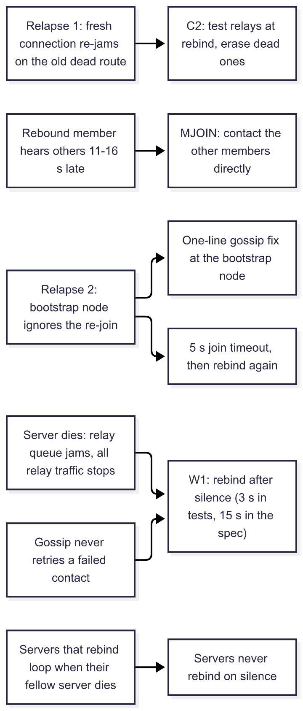
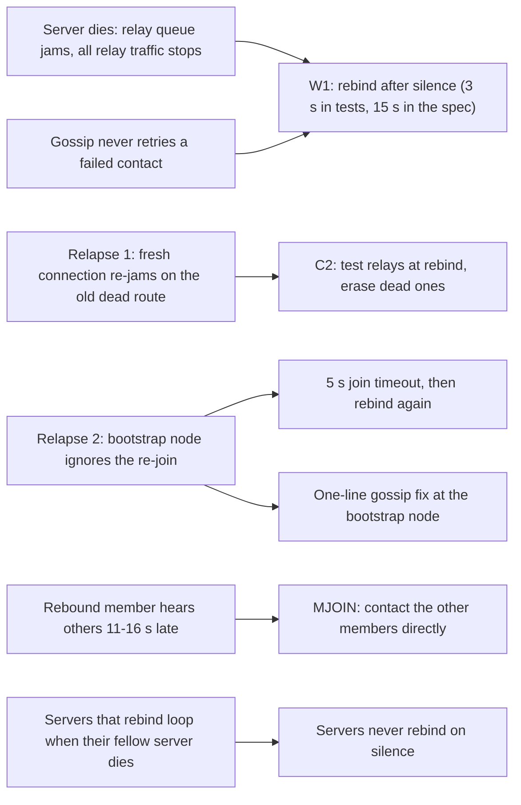
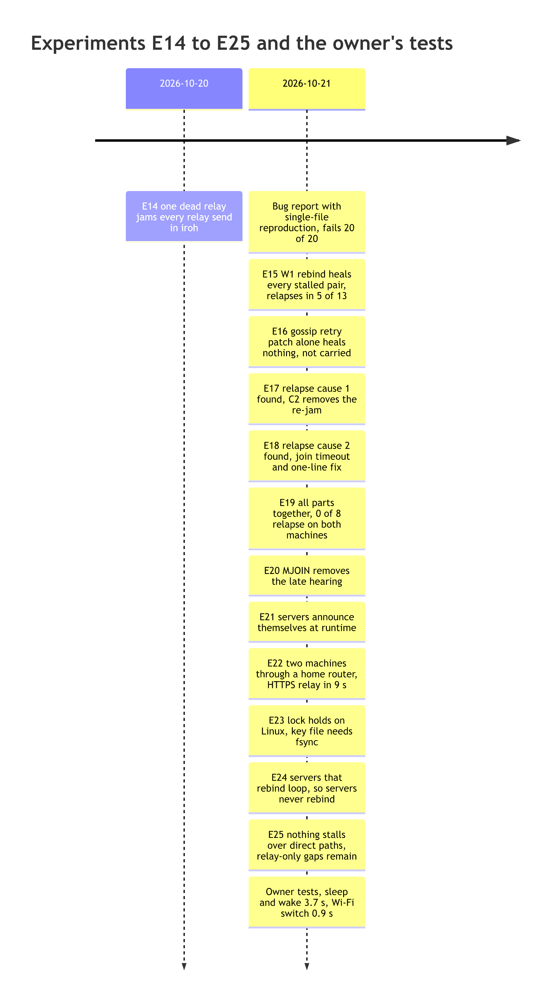
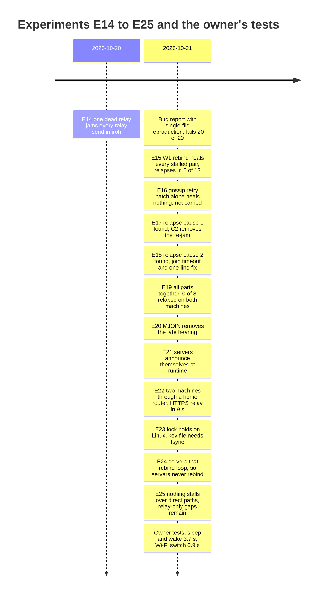

# Showcase: two days of stack research (2026-10-20 and 2026-10-21)

Diagrams are rendered to PNG with merman-cli 0.9.1 (commons tip; `merman-cli render -f png -b white -s 2`); the Mermaid sources sit beside them in showcase/.

For the owner, read cold. Every figure here comes from a report under research/stack/; the ledger (research/stack/ledger.md) holds the full record, item by item, and research/stack/README.md indexes the whole research.

## In one paragraph

When one of our servers dies, estafette's members stop hearing each other for minutes, even members that never used that server. The cause is a bug in iroh, the networking library we build on. We found it, proved it, and wrote a bug report you can post upstream. We also built a workaround that our own code can carry today: on the Mac and on a Linux server, with the full workaround, every member was hearing every other member again within 28 seconds of a server's death in every run (8 runs on each machine). A new server can now announce itself to a running network, with no restart and no configuration edit on members. Last, the tests left one machine: across a home router and two rented servers, over HTTPS relays, no run stalled after a server's death while members could reach each other directly; two gaps remain where every path runs through a relay, and you accepted them.

## Words used below

- **Member**: one running estafette node, the process behind an agent's card.
- **Server** (a "host" in the reports): a machine you run. It carries two services: a **relay**, which forwards traffic between members that cannot reach each other directly, and a **bootstrap node**, the first contact a member uses to join the network.
- **Gossip**: how members spread announcements to each other (who is online, at what address). It runs on iroh-gossip, a companion library to iroh.
- **Heartbeat**: in the tests, each member sends a tiny message every second. A pair of members is **stalled** when one has heard nothing from the other for 5 seconds or more; **flowing** when heartbeats arrive again.
- **Recovery time**: seconds from the server's death until every stalled pair flows again.
- **Rebind**: a member throws away its whole network connection and opens a fresh one with the same identity key, then rejoins through a server. It costs every open connection.
- **Relapse**: a member recovers, then stalls again and needs a second rebind.
- **Upstream**: the people who maintain iroh (the company n0). **Unreleased**: fixed in their latest code but not in any version we can depend on yet.

## What was tested, and on what

- **The Mac**: an Apple M2 Max running macOS 15.3.1. All E14-E21 experiments ran here first.
- **A Linux server**: a rented Hetzner machine (Ubuntu 24.04.4, 2 virtual CPUs, 3819 MiB memory), set up for this work and run by a sibling agent session (lab-sibling). Every result from E14 to E20 was rerun there; E21 was rerun there too (lab/linux/linux-e21: same outcome, the self-announcing arm flowing from 6.8-6.9 s).
- **The test network**: three members and two servers, all on one machine, talking over its internal network. The test kills one server outright (both its relay and its bootstrap node) and watches heartbeats for 180 seconds. Most comparisons run 8 times per variant; "n" below is the number of runs.
- From E22 on: real machines. The Mac behind your home router (NAT), the Linux lab server in Nuremberg, and a throwaway server in Helsinki, with relays over HTTPS. Not tested: a stricter router than yours, or a network that blocks direct paths.

## Finding 1: the relay bug in iroh (E14 and the bug report)

What happens. A member sends all its relay traffic through one internal queue that serves every relay. When a relay is dead, the small waiting line for that relay (64 slots) fills up and is never emptied, and the shared queue then waits on it forever. From that moment nothing goes through any relay, live ones included. It clears only when iroh gives up on the dead relay after about 60 seconds of inactivity, and any further traffic toward the dead relay starts it again.

How we know.
- E14 (2026-10-20, Mac) traced it in the iroh source and reproduced it with a small program: one connection attempt per second toward a member behind the dead relay jammed it 17 seconds after the death; five per second, 4 seconds.
- The bug report (experiments/e14-bug-report.md) shows the trigger is a count, about 65 or more messages addressed to the dead relay. Its single-file reproduction fails 20 of 20 times on iroh 1.3.0 (our version) and 20 of 20 on iroh's newest code (1.4.0), and passes every control. A diagnostic patch showed the full queue directly. Two candidate fixes each passed 20 of 20.
- On Linux the same reproduction failed 19 of 20 (1.3.0) and 18 of 20 (newest), with controls and both fixes as on the Mac.
- iroh's own levers do not help: removing the dead relay from the list, or forgetting the dead peer's address, changed nothing.

The package. experiments/e14-bug-report.md is written to go upstream unchanged: summary, environment, the reproduction and how to run it, the mechanism with source lines, the proof, two candidate fixes with their trade-offs, and what could make it wrong. The directory experiments/e14-bug-report/ packages it for posting: README.md (the report), ISSUE.md (short text for a GitHub issue), the reproduction programs, run.sh (rebuilds every count), and the raw Mac and Linux results. You ruled that you post it.

## Finding 2: the workaround, built up from E15 to E20

The base rule (W1, E15): a member that hears no heartbeat from anyone for 3 seconds rebinds, at most once every 20 seconds. A fresh connection stack has a fresh, empty relay queue. It healed every stalled pair (76 of 76 on the Mac, 48 of 48 on Linux), against 0 of 24 (Mac) and 0 of 12 (Linux) with no rule. But 5 of 13 Mac runs relapsed, and the next four experiments chased why.

- **E16**: gossip never retries a member it once failed to reach (fixed upstream, unreleased). Patching that alone healed nothing, and with our earlier rejoin rule it made the jam worse. We do not carry that patch; the rebind already starts gossip afresh.
- **E17**: relapse cause 1. The fresh connection still remembers the old route through the dead relay and sends to it again, so the jam returns about 57 seconds after the rebind. The answer (C2, 24 lines): at rebind, test each configured relay with a plain connection attempt and erase dead relays from the stored addresses of other members.
- **E18**: relapse cause 2. After a rebind, the surviving bootstrap node can ignore the member's join because of a leftover request from before the crash. The member waits about 60 seconds. Two answers: the member gives up after 5 seconds and rebinds again; and the bootstrap node gets a one-line fix that upstream already made (unreleased), carried through Cargo's standard way of patching a dependency.
- **E19**: all parts together. On both machines, 0 of 8 runs relapsed. Without C2, 5 of 8 (Mac) and 4 of 8 (Linux) relapsed, so C2 earns its place. The cost on the Mac: about 14 seconds slower than W1 alone whenever W1 alone would not have relapsed.
- **E20**: the 14 seconds explained. A rebound member whose only neighbor is the bootstrap node hears the others late, 11 to 16 seconds. The answer (MJOIN, 13 lines): after a rebind, a member with no other member as a neighbor contacts the other members directly every 3 seconds until one becomes a neighbor. Late members went from 5 of 21 to 0 of 24 (Mac). On Linux the full set healed faster than without MJOIN (median 15.9 s against 20.1 s).

### (a) The parts and the failure each answers

Mermaid source (showcase/diagram-1.mmd)

### (b) Timeline of the experiments

Mermaid source (showcase/diagram-2.mmd)

### (c) Recovery time, W1 alone against the combined workaround

Seconds from the server's death until every stalled pair flows again: median (fastest to slowest). "Relapsed" counts runs that needed a second rebind. A run that never stalled is left out of the times.

| Variant | Machine | Runs (stalled) | Recovery, median (range) | Relapsed | Report |
|---|---|---|---|---|---|
| W1 alone | Mac | 8 (8) | 17.1 s (15.7-148.8; one run never fully recovered) | 3 of 8 | E19 |
| W1 alone | Linux | 8 (7) | 18.7 s (13.0-145.7) | 2 of 8 | linux-e19 |
| Combined without MJOIN | Mac | 8 (7) | 31.2 s (29.3-33.2) | 0 of 8 | E19 |
| Combined without MJOIN | Linux | 8 (8) | 20.4 s (14.2-34.7) | 0 of 8 | linux-e19 |
| Full fix (with MJOIN) | Mac | 8 (8) | 18.1 s (14.5-28.0) | 0 of 8 | E20 |
| Full fix (with MJOIN) | Linux | 8 (7) | 15.9 s (14.1-19.0) | 0 of 8 | linux-e20 |

Read with care: the same "combined without MJOIN" setup gave a Mac median of 31.2 s in E19 and 18.0 s in E20, so one set of 8 runs can move by that much. What holds across every run set: the combined workaround removed the long tail (no run past 35 s) and the relapses.

## Finding 3: servers that announce themselves (E21, Mac and Linux)

What it does. Each server joins the network and broadcasts a signed record (its relay and bootstrap addresses) every 5 seconds. Members add it on the fly and save it to a file for their next start.

What was measured (n=5 per variant, full workaround on).
- A server started on a running network reached every member in 24 to 114 milliseconds, with no restart.
- When the first server then died, all 15 members moved to the new one and every pair was flowing again in 5.9 to 7.0 seconds, with no relapse. The comparison against a pre-configured server is confounded, so this does not show "learned is faster than configured".
- A new member that knew only the new server joined in about 10 milliseconds. A restarted member with the saved file joined; without it, it never joined (one run each).
- Surprise: adding a relay makes iroh re-pick its preferred relay, and it switched 11 of 15 members to the new one.
- Gap: nothing in the spec tells a real server from any member holding the network secret, so any member could pose as a server. The experiment added a key of yours that certifies each server, which you then ruled on.

## Finding 4: two real machines and an HTTPS relay (E22)

What was measured, between the Mac behind your home router and the lab server.
- HTTPS was low-effort: the stock relay with a 10-line configuration got a trusted Let's Encrypt certificate 9.15 seconds after its first start; a restart loads it from cache in 2 milliseconds. HTTPS costs 87 milliseconds more to come online and nothing measurable after that. On the wire, an observer sees only the server's name.
- One setting matters: a relay without QUIC address discovery makes a member take 3.1 seconds to come online; with it, 0.49 seconds.
- Through the router, each machine reached the other 20 of 20 times, by relay alone and with a direct path found about 200 milliseconds after the dial. Gossip carried 120 of 120 heartbeats each way.
- Caveat: your router keeps port numbers, which makes it easy to cross. That proves this router, not routers in general.

## Finding 5: the identity lock on Linux and a power cut (E23)

The lock that keeps one live member per card behaves on Linux as on the Mac: a second instance was refused 5 of 5 times, and the lock was free 154-232 microseconds after the holder was killed. A throwaway server was hard-reset 20 times. The lock was free on every boot, but the card's key file, written without a flush to disk and cut 1-2 seconds later, was gone 5 of 5 times: the member would have lost its identity. With a flush of the file and its directory, it survived 5 of 5. The spec now requires that flush.

The same experiment showed the re-announce rule (S13) would announce about 20 times in 12 seconds while a relay is down, with the address unchanged; the spec now announces only a changed address, at most once every 2 seconds.

## Finding 6: the workaround across machines (E24, E25)

The spec's trigger differs from the tests': a member counts as deaf after 15 seconds without any gossip from anyone (your ruling), with each server's record every 5 seconds as the floor.
- E24 found a flaw in the spec as first written: servers that also rebound on silence, with their only fellow server dead, rebound about every 8 seconds and dragged members along. With every path through a relay, 7 of 8 runs had not recovered after 120 seconds. With direct paths allowed, the rule itself caused an outage in 4 of 4 runs. The spec now says servers never rebind on silence. With that, every member rebound once and all pairs flowed again 32.6-33.1 seconds after the death (4 runs).
- Across machines, a new server reached all four members 319-379 milliseconds after it started, and a new member that knew only that server joined in 290-304 milliseconds.
- E25, servers without the rule, 8 runs per variant: with direct paths allowed, as a product runs, no run stalled after a server's death (0 of 16). With every path through a relay, the surviving server was itself jammed by the iroh bug in 10 of 21 runs, for 62.6-87.3 seconds, before clearing by itself. In one further run, members kept hearing server records while 8 of 12 pairs stalled for 71 seconds, so the deaf rule could not fire.

## Your own tests (2026-10-21)

You ran two tests by hand, with the Mac's members talking to members on the servers.
- Sleep and wake: the Mac slept 247.5 seconds. On waking, each Mac member rebound at once, and all 10 pairs were flowing again within 3.7 seconds, with no failed join.
- Wi-Fi to your phone's hotspot: the public address changed and the network was down about 4.8 seconds. No member rebound; all 10 pairs resumed within 0.9 seconds. At the end the remote side no longer heard the Mac, most likely because you switched back to home Wi-Fi; that is not confirmed.

## What you ruled (2026-10-20 and 2026-10-21)

- Every announcement carries the sender's full current address (19:06); the network admission check runs inside iroh's connection hook, both ways (19:06); old announcements expire after 300 s (19:06).
- Servers announce themselves; members add them at runtime and remember them (19:10). No n0 services at all (19:24). Public card fields stay in announcements, capped at 3 KiB (19:20).
- Parameters two independent pieces must agree on: approved as drafted (19:32).
- Lab server: Hetzner CX23 x86 in Nuremberg (20:31); later "Keep 24 h more", lab resources extended to 2026-10-22T18:00Z.
- Relay death, first step: our own fix on the current gossip version, measured first (21:40); the stdin fix: measure it (21:40); MCP values approved as drafted (21:40).
- The iroh relay bug: build our workaround and write a detailed bug report (2026-10-21 00:00); you post the report yourself (12:25).
- The workaround: "Full fix", MJOIN included, goes toward the spec (12:30).
- The one-line gossip fix: carry it through Cargo's dependency patching, drop it when a release carries it (12:30).
- Server trust: "Guard it with your key" (12:34): your public key in the network config, one certificate per server, members accept server records only from certified servers.
- Relay encryption: "if low-effort high-benefit, we commit to https" (14:35); and "apply current changes, carefully" (14:35).
- Power cut: a throwaway server, if simulating is harder than the real thing (14:40); its type: "cpx22, x86" (15:00).
- The deaf trigger: "haven't heard anyone in 15s" (15:15).
- Cross-machine tests: "All, with a 2nd server"; your hands-on part: "I ping you when ready" (16:26).
- The close (23:10): "this is as far as i'm willing to go in spec itself."

Every staged change, S1-S27, is now in spec/blueprint.md, applied on 2026-10-21 and checked by two reviews (research/stack/spec-apply-report.md, spec-review.md, spec-review-2.md).

## What remains open

- **Your action**: post the bug report.
- **Known limitations, accepted at the close**:
  1. With every path through a relay, a surviving server can be jammed by the iroh bug for 62-87 seconds, and the spec gives a server no recovery rule (E25).
  2. The deaf rule cannot fire for a member that keeps hearing server records while it cannot reach its peers (one run, 71 seconds; E25).
  3. A network with no direct paths was only simulated, by turning direct paths off; no such network was met (E22, E24, E25).
  4. QUIC address discovery in the relay library the spec embeds is unconfirmed; the tests ran the stock relay program (spec-apply-report.md).
- **Not explained**: why the bootstrap node's relayed heartbeats arrive 11-16 s late; why members already moved to the new server still stalled when the old one died (2 of 2 runs in E21); how much traffic a real member sends toward a dead relay (the tests sent one probe per second); why a jammed server clears after 62-87 seconds (E25 did not instrument it).
- **Product needs**: MJOIN needs a list of the other members in the product; the 5 s join timeout costs a full rebind whenever a legitimate join is slower than 5 s.
- **Upstream**: the gossip fixes we lean on (#161, #178) are unreleased; iroh's relay bug is unfixed in the newest code we checked (main 55908a5).

## Where everything lives

- research/stack/README.md: the index, with one table of every experiment, its report, rerun, code, and the items it settles.
- research/stack/ledger.md: status at a glance, every collision (C1-C19) and revision (S1-S27), the known limitations, and the evidence by item.
- research/stack/experiments/e14-dials.md to e25-hosts-norule.md: one report per experiment; e14-bug-report.md and the directory e14-bug-report/ are the upstream package.
- research/stack/lab/linux/: the Linux reruns (linux-e14, linux-e14w, linux-e14-repro, linux-e15, linux-e17 to linux-e21).
- spec/blueprint.md: the applied spec; research/stack/staged-revisions.md: the intended text it was applied from; research/stack/parameters.md: the approved parameter values.
- Code: the estafette repository, branches spike/e14-dials, spike/e14-bug-report, spike/e15-workaround to spike/e21-hosts, spike/e22-two-machines, spike/e23-lock, spike/e24-cross (pushed).
- docs/orchestration_log/history/2026-10-15/events.md: the journal, with every ruling quoted.
